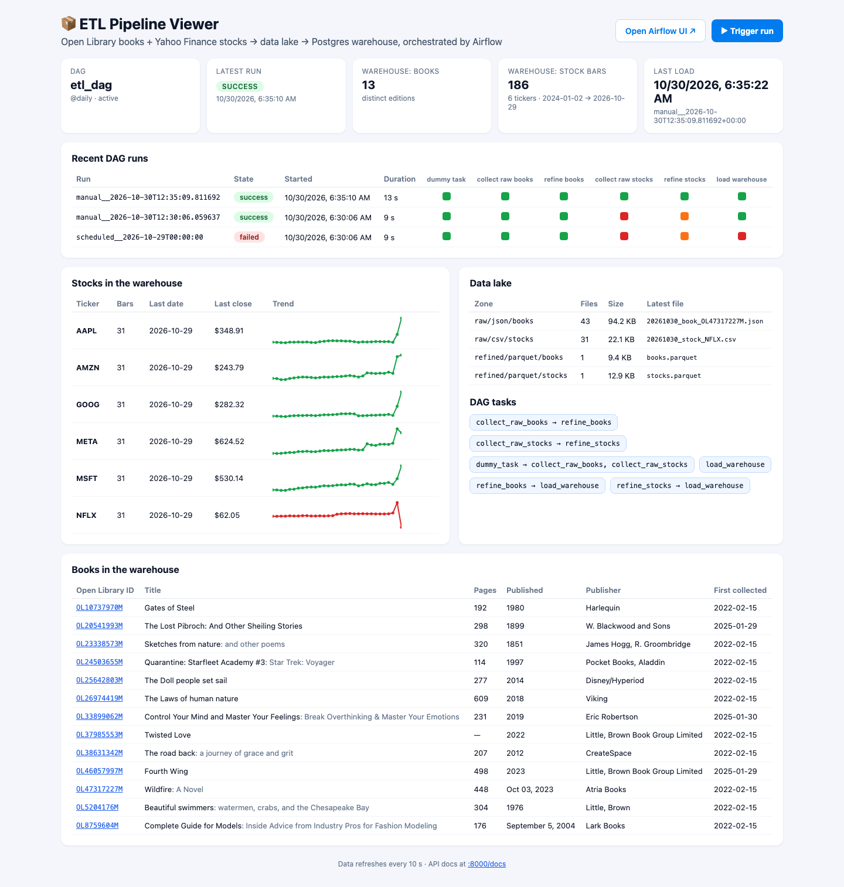
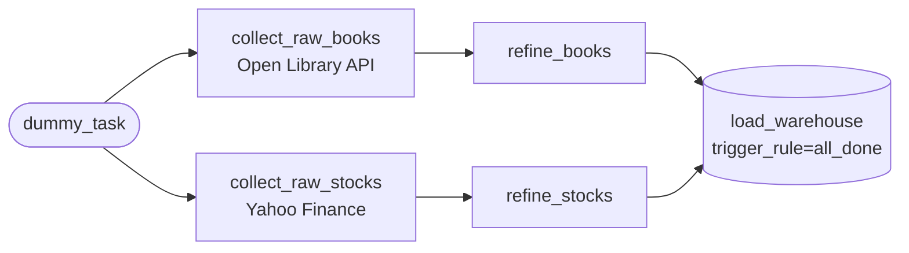
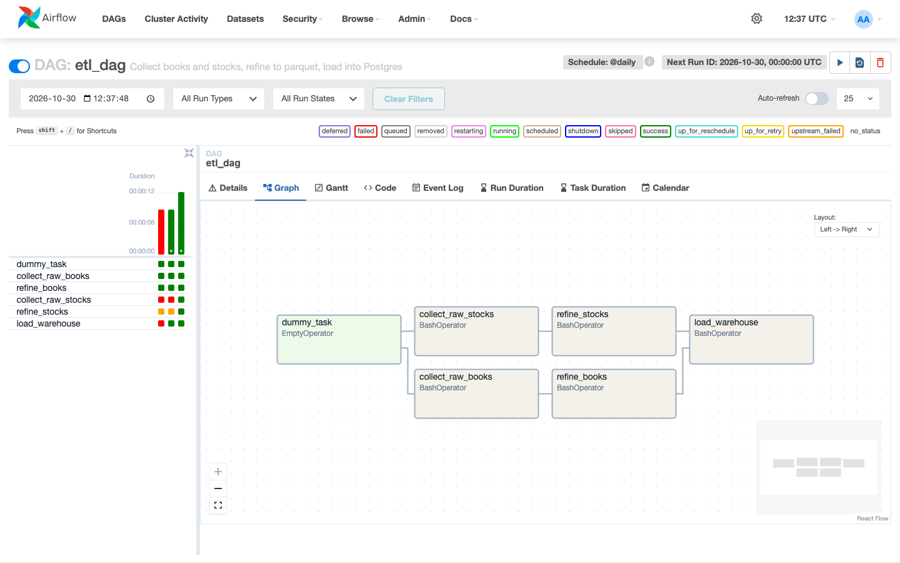
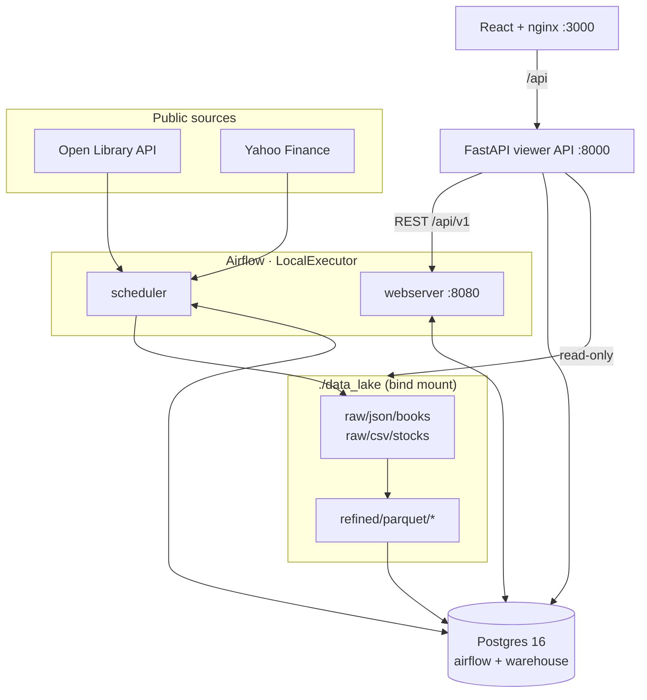
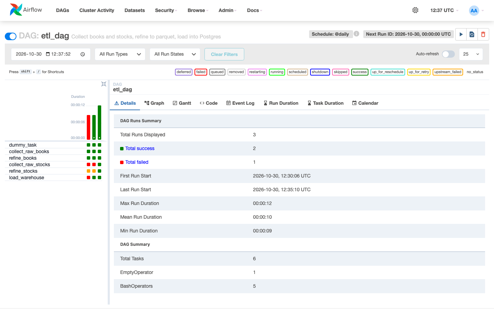
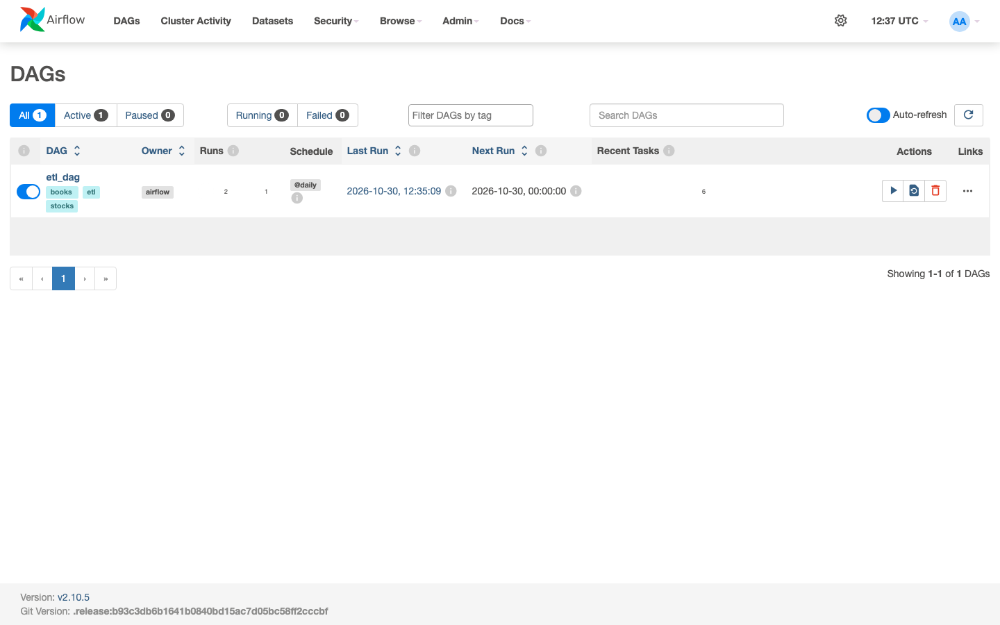
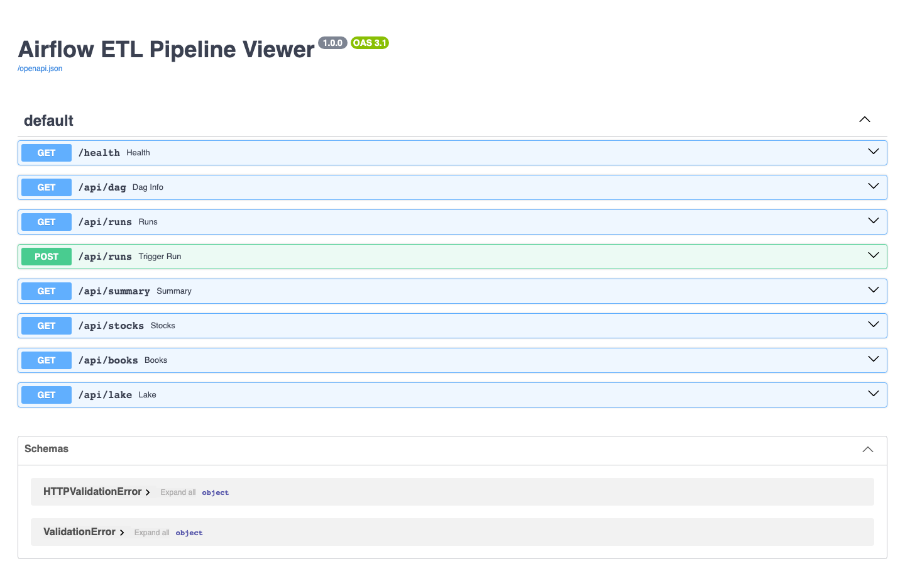

# 📦 Airflow ETL Pipeline

> **Books from Open Library and daily stock bars from Yahoo Finance → a file-based data lake → a Postgres warehouse.** Apache Airflow orchestrates the pipeline. A small FastAPI + React viewer shows each run and what it produced.



---

## 1. The idea in one slide

| | |
|---|---|
| **Extract** | `collect_raw_books` calls the Open Library API. `collect_raw_stocks` pulls the previous trading day's OHLCV bar from Yahoo Finance via `yfinance`. |
| **Transform** | `refine_books` and `refine_stocks` turn raw JSON/CSV into typed, de-duplicated parquet. |
| **Load** | `load_warehouse` writes the parquet into the Postgres `warehouse` database (`books`, `stocks`, `load_audit`). |
| **Observe** | The viewer (`:3000`) reads Airflow's REST API and the warehouse: run history, task states, the loaded data, and data-lake file counts. |

No API keys are needed: both sources are public.

## 2. Quick start

```bash
cp .env.example .env          # optional; every value has a local default
docker compose up --build     # first build takes a few minutes
```

| Service | URL | Notes |
|---|---|---|
| Pipeline viewer (React + nginx) | http://localhost:3000 | **▶ Trigger run** unpauses `etl_dag` and starts a run |
| Airflow UI | http://localhost:8080 | local login `admin` / `admin` (from `.env`) |
| Viewer API (FastAPI) | http://localhost:8000/docs | |
| Postgres | `localhost:5433` | databases `airflow` (metadata) and `warehouse` |

Stop with `docker compose down`. Add `-v` to also drop the Postgres volume.

On first start, `airflow-init` migrates the metadata DB, creates the local admin user, and seeds `./data_lake/` (gitignored) from `sample_data/data_lake/`. Runs then append to that seed data.

## 3. Pipeline





| Param | Default | Meaning |
|---|---|---|
| `open_library_ids` | 7 edition IDs | Books to fetch. A book first collected more than 12 months ago is not re-fetched. |
| `stock_tickers` | AAPL, MSFT, AMZN, META, NFLX, GOOG | Tickers to fetch |
| `stock_collect_mode` | `normal` | `normal` fetches the bar for the day before the run. `fill_missing` backfills gaps in the date range below. |
| `start_date_missing_values` / `end_date_missing_values` | none | Date range for `fill_missing` |

The DAG runs `@daily` (`catchup=False`, `max_active_runs=1`) and is created paused.

## 4. Architecture



## 5. What a run looks like

The run history is real: it comes from this stack on Oct 30, 2026.



- The two earlier failed runs exposed a bug that this PR fixes. The DAG renders templates as native Python objects, so empty date params reached `BashOperator` as `None` and the task crashed. Unpausing also created a scheduled run alongside the manual one, and both wrote to the same warehouse tables at once.
- After the fix, the latest run went green end to end in 13 s.
  - It fetched real Yahoo Finance bars for 2026-10-29 (e.g. AAPL closed at $348.91).
  - It fetched fresh Open Library records.
  - It loaded 186 stock bars and 13 distinct books into Postgres.



The viewer API:



| Endpoint | Returns |
|---|---|
| `GET /api/dag` | DAG metadata and task graph |
| `GET /api/runs` · `POST /api/runs` | Recent runs with per-task states · trigger a run |
| `GET /api/summary` | Warehouse counts, date range, last load |
| `GET /api/stocks` · `GET /api/books` | Warehouse rows |
| `GET /api/lake` | File counts and sizes per data-lake zone |

## 6. Fixes made while productionizing

| Problem | Fix |
|---|---|
| `utils.save_data` ran `pd.to_numeric` on `YYYY-MM-DD` strings, so **every date in the refined parquet became NA** | Dates are parsed to real tz-naive datetimes. A regression test covers this. |
| Edition IDs (`…M`) were requested from `/works/` | Requests now go to `/books/`. Failed fetches are skipped instead of writing `null` files. |
| `yfinance 0.2.36` no longer works against Yahoo, and new versions reject custom `requests` sessions | Upgraded `yfinance` and dropped the custom cache/limiter session |
| `Variable.get` at import time failed without Variables set, or without a DB (CI) | Paths come from the environment, with defaults |
| Empty default params meant scheduled runs fetched nothing | Default book IDs and tickers added |
| No load step | `load_warehouse` task plus a `warehouse` DB and a `load_audit` table |
| Celery + Redis stack for a 6-task DAG | LocalExecutor; Postgres serves both metadata and the warehouse |

## 7. Tests and CI

```bash
uv sync && uv run pytest -q tests --ignore=tests/dags   # ETL + API unit tests (10)
docker compose build airflow-init && docker run --rm -v "$PWD:/repo" -w /repo --entrypoint bash \
  airflow-etl-pipeline/airflow:local -c "pip install -q pytest && python -m pytest -q tests/dags"
```

GitHub Actions runs three jobs:

- **Unit tests:** refine/load logic on a copy of `sample_data`, plus the API with Airflow mocked.
- **DAG import tests:** a `DagBag` with no import errors and the expected task graph, run inside the Airflow image.
- **`docker compose build`:** runs after both test jobs pass.

## 8. Repo layout

```
airflow/            Dockerfile, requirements, dags/my_first_dag.py (etl_dag)
data_collection/    collect_* / treat_* / load_warehouse.py / utils.py
api/                FastAPI viewer API
frontend/           Vite + React + TypeScript viewer, served by nginx
postgres/           init SQL (creates the warehouse DB)
sample_data/        seed data lake (small, committed)
tests/              unit tests; tests/dags runs inside the Airflow image
scripts/            screenshots.py (Playwright)
docs/               screenshots, ORIGINAL_README.md
legacy/             old compose, logs, stray files (moved, not deleted)
```

Screenshots are regenerated with `uv run --with playwright python scripts/screenshots.py` against a running stack.

---
MIT License. The original README is preserved at [docs/ORIGINAL_README.md](docs/ORIGINAL_README.md).
